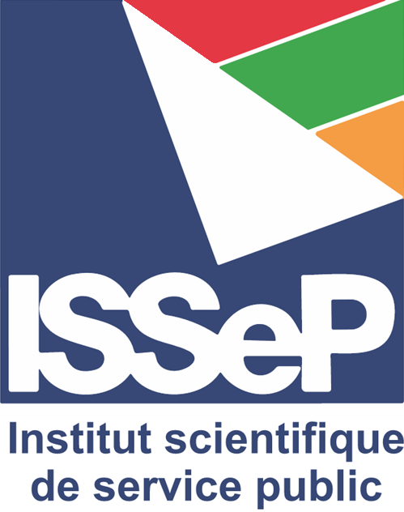

::: {style="min-height: 90vh; min-height: 90svh; display: flex; flex-direction: column; justify-content: center; align-items: center; text-align: center;"}

# Pablo PADILLA

## Biostatisticien

### Accompagnement & Formations

[contact@pablo-padilla.com](mailto:contact@pablo-padilla.com)

:::

::: {style="min-height: 65vh; display: flex; flex-direction: column; justify-content: center; align-items: center; padding: 3rem 0;"}

## Ils m'ont fait confiance

::: {.columns}
::: {.column width="33.33%"}
{fig-align="center" width="150px"}
:::
::: {.column width="33.33%"}
{fig-align="center" width="150px"}
:::
::: {.column width="33.33%"}
{fig-align="center" width="150px"}
:::
:::

::: {.columns}
::: {.column width="33.33%"}
{fig-align="center" width="150px"}
:::
::: {.column width="33.33%"}
{fig-align="center" width="150px"}
:::
::: {.column width="33.33%"}
{fig-align="center" width="150px"}
:::
:::

:::

::: {style="min-height: 65vh; display: flex; flex-direction: column; justify-content: center; text-align: center;"}

## À propos

On attend des chercheurs qu’ils maîtrisent aussi bien leur discipline que la statistique et la programmation. Pourtant, nous n’allons pas chez le pharmacien pour un diagnostic, ni chez le médecin pour ses médicaments.

Issu de la recherche scientifique, j’ai moi-même été confronté à ces défis. J’ai été surpris de découvrir la diversité des tests statistiques et la richesse de leurs applications, et j’ai progressivement trouvé dans la programmation un moyen de gagner en autonomie et en efficacité, bien au-delà du seul cadre scientifique.

Aujourd’hui, je mets ces compétences au service des chercheurs afin de leur permettre de tirer pleinement parti de leurs données tout en se consacrant à leurs questions de recherche.

Retrouvez quelques exemples de mes travaux et collaboration dans mes [Projets](projects.qmd).

:::

::: {style="min-height: 45vh; display: flex; flex-direction: column; justify-content: center; align-items: center; text-align: center;"}

## Me retrouver en ligne

[{style="width: 48px; margin: 0 18px;"}](https://scholar.google.com/citations?user=vUUMNRMAAAAJ&hl=fr)
[{style="width: 48px; margin: 0 18px;"}](https://www.linkedin.com/in/pablo-padilla-analyst/)

:::